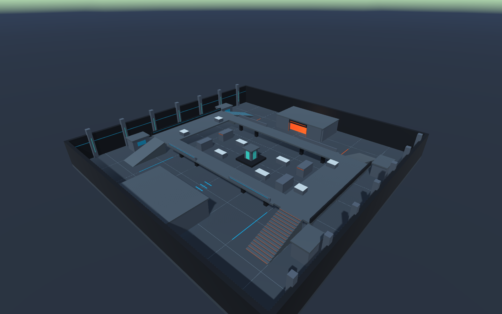
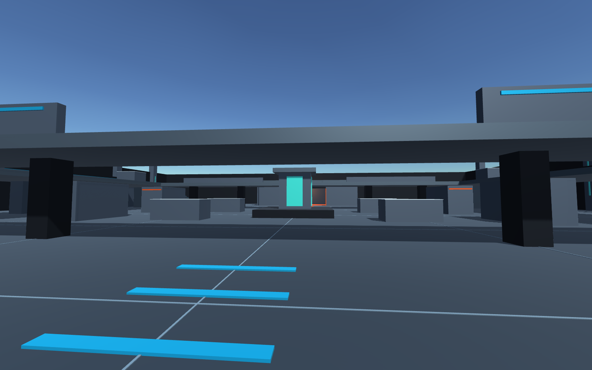
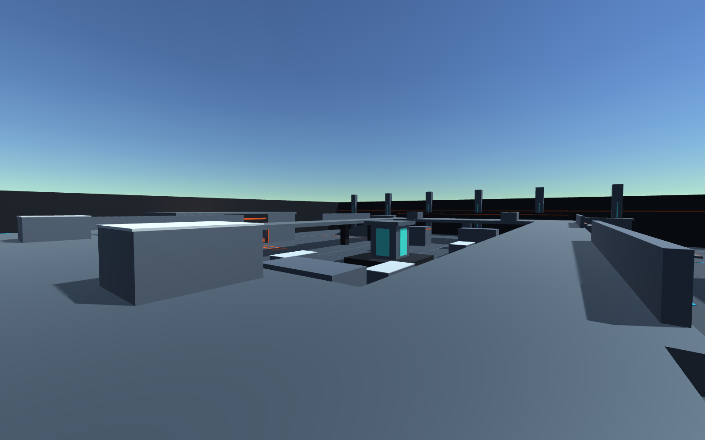

# Phase 1 실제 검증 결과

검증일: **2026-11-05 (Asia/Seoul)**. Phase 1의 맵 자동 생성과 실제 Unity Play Mode 검증을 통과했다. [PR #9](https://github.com/BaeJiwoo/overwatch_duplicate/pull/9)는 사용자 검토 대상이며 자동 병합하지 않는다. 멀티플레이어 게임 전체의 완료를 의미하지 않는다.

## 환경

- Windows 11 x64
- .NET SDK 10.0.403 / .NET runtime 10.0.14
- Unity Editor 6000.3.11f1 실제 실행, 라이선스 활성화 확인
- Direct3D 11 / NVIDIA GeForce RTX 3070
- Shared: netstandard2.1 / C# 9
- 맵: 80m × 80m, 객체 222개, 스폰 8개
- Map SHA-256 (UTF-8 / LF): `cf19ef292e38f64395f0a4ff7511c00fce792607fc1394c9dbc75e69b7fd45ff`

## 실행 확인

| 검사 | 결과 | 실제 확인 범위 |
|---|---|---|
| `dotnet build FPSPrototype.slnx -c Release -m:1` | 통과, 경고/오류 0 | Shared/Server/Tests 컴파일 |
| .NET 테스트 실행 | **29 passed, 0 failed** | 잘못된 맵 거부, 순수 C# 기하, 스폰/경로/계단/외벽 |
| 서버 `--validate-map` | 통과, 종료 코드 0 | Unity 없이 동일 JSON 로드/검증/해시 |
| `dotnet build Tools/UnityCompileCheck/UnityCompileCheck.csproj -c Release -m:1` | 통과, 경고/오류 0 | 설치된 Unity DLL을 참조한 C# API 컴파일 검사 |
| Unity Package Manager / asmdef 컴파일 | **통과** | Shared 로컬 패키지와 Client/Editor assembly import·컴파일 |
| Editor 맵 생성 | **통과** | Scene, 222개 객체, 8개 스폰, Mesh/Materials/Colliders/Lighting/MapConfiguration |
| 동일 설정으로 2회 생성 | **통과** | 기하 fingerprint와 자산 GUID 집합 동일 |
| Shared / Unity Collider 대조 | **1,030개 통과** | AABB·Ramp 표면과 Ramp 옆면/빈 공간 |
| 실제 Play Mode | **통과, 종료 코드 0** | 카메라/MapConfiguration, 기하 재검사, 지면 ray와 스폰 overlap |
| 실제 카메라 렌더 및 시각 확인 | **통과** | 전체 조망, 지상, 고지대 PNG 각각 1600 × 1000 |
| GitHub Actions / Ubuntu 24.04 | **통과한 기준본 기록 참조** | solution build, 29개 테스트, 서버 맵 검증 |

원격 CI 근거: [Shared and server checks #2](https://github.com/BaeJiwoo/overwatch_duplicate/actions/runs/41951214895), 구현 커밋 `f5cfdf982e4f3f79060b12f912123ab0f005a0ba`. 최신 변경의 결과는 [PR Checks](https://github.com/BaeJiwoo/overwatch_duplicate/pull/9/checks)에서 확인한다. GitHub Actions는 .NET 검사를 수행하며 Unity Editor/Play Mode는 위 Windows 환경에서 실제 실행했다.

우회로 몸체 여유 공간 테스트가 최초에 실패하여 외곽 건물을 1m 안쪽으로 이동했고, 같은 테스트가 통과하는 것을 확인했다.

로컬 실행 원본 로그는 `Artifacts/dotnet-build.log`, `Artifacts/dotnet-tests.log`, `Artifacts/server-map-validation.log`, `Artifacts/unity-api-compile.log`, `Artifacts/unity-validation.log`에 있다. 환경 정보가 포함된 로컬 로그 전체는 커밋하지 않는다.

## Unity 실행 증거

커밋한 기계 판독 보고서: [phase1-validation.json](Evidence/phase1-validation.json).

```text
passed: true
editorGeneration: true
deterministicRegeneration: true
colliderParity: true
playMode: true
objects: 222
spawns: 8
rayChecks: 1030
```

기하 fingerprint: `e3e5dd4fb819e0e09f7e73a2a2a1296d991558636c04b9c83fc21c3b527e6661`.







시각 확인에서 양쪽 계단/경사로, 다리와 고지대, 중앙 엄폐, 외곽 벽, 진영별 색상과 발광 재질이 표시되는 것을 확인했다. PNG는 Play Mode의 Camera.Render로 캡처했으며 편집된 모형이나 예시 이미지가 아니다.

## 수정한 실행 문제

최초 실행은 라이선스 오류 198로 중단됐고, 사용자 활성화 후 해소됐다. 이후 새 프로젝트에서 자동 검증이 Editor 검색 인덱스 초기화보다 먼저 Play Mode를 요청해 Unity 내부 예외가 발생했다. Play Mode 요청을 Editor의 시작 시 지연 콜백 이후로 옮겨 해결했고, 검색 인덱스가 없는 상태에서도 성공했다. 최종 코드로 다시 실행해 같은 기하 fingerprint와 전체 성공 보고서를 확인했다.

Editor가 정규화한 프로젝트 설정과 Packages lock 파일을 저장했다. 생성 Scene의 GUID를 담는 EditorBuildSettings는 checkout별 생성 자산이므로 버전 관리에서 제외하며, 맵 생성기가 build scene 목록을 다시 설정한다.

검증 코드는 `Client/Assets/Editor/Phase1Validation.cs`와 `Tools/Validate-Unity.ps1`에 있다. 재실행: `pwsh -File Tools/Validate-Unity.ps1`.

## 아직 구현하지 않은 범위

LiteNetLib UDP, 임시 세션, 30 TPS 실행 루프, 서버 플레이어 이동 솔버, FPS 점프/사격/탄약/HP/리스폰, 예측·보간·재조정, Docker 및 Unity A/B 통합 플레이는 Phase 2~7 Issue의 범위다. 서버 CLI의 맵 검증 성공은 이 기능들의 실행 성공을 의미하지 않는다.

이번 검증은 자동 Play Mode smoke와 카메라 렌더 검사다. 실제 키보드·마우스 입력을 이용한 수동 조작, standalone 클라이언트 빌드, 네트워크 플레이는 이 실행에서 검증하지 않았다.
